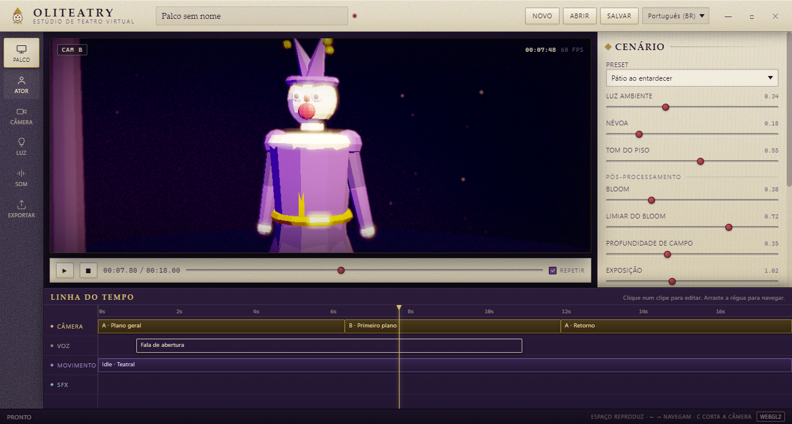
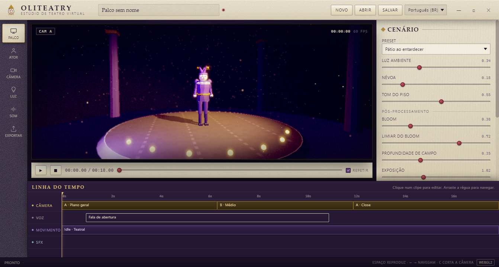

# OLiteatry

**A free, open-source desktop studio for virtual theatre, avatar performance and machinima.**
Parchment-and-violet interface, PS2-era post stack, and a procedural idle-motion engine that keeps a talking character from looking like a statue.



> **Status: v0.1.0 — reference host.** This build is the *working vertical slice*: an Electron + three.js
> desktop app that proves the pipeline end to end (timeline → camera cuts → procedural performance →
> lip-sync → post → recording). The production engine plan (Unity 6 + URP, VRM import, auto-rigging)
> lives in [`docs/ARCHITECTURE.md`](docs/ARCHITECTURE.md) and is **not** what this binary is yet.
> Read [“What is not here yet”](#what-is-not-here-yet) before filing a feature request.

---

## What works today

| Area | Implemented |
|---|---|
| **Shell** | Frameless desktop window, custom parchment UI, seven modules (Stage, Actor, Objects, Camera, Light, Sound, Export) |
| **Localization** | Full UI in **pt-BR and en**, switchable at runtime, plural-aware catalog lookups, per-locale number formatting |
| **Stage** | Three presets (courtyard / void / tavern), stone floor, curtain cyclorama, pillars, footlights, dust motes |
| **Lighting** | Key / fill / rim with colour, azimuth, elevation, intensity; shadow-casting key |
| **Cameras** | Two cameras A/B, five framing presets, focal length, height, distance, target height, handheld shake |
| **Transitions** | Hard cut, fade and wipe, composited in the post stack — no scene reloads |
| **Post** | Bloom (bright-pass + gaussian), depth-of-field, ACES-ish tonemap, grade, vignette, paper grain, **PS2 mode** (dither + colour quantisation + scanlines + low internal resolution) |
| **Performance engine** | Seeded, deterministic pipeline: speech-driven visemes, prosody, gesture FSM with cooldowns, blink/saccade/breath micro-layer, additive composition |
| **Voice** | Offline formant "scratch" synthesiser that plays exactly the viseme track (so audio and mouth can never disagree); ElevenLabs adapter slot is defined, key not bundled |
| **Subtitles** | SRT export generated from the same word timings used for lip-sync |
| **Stop-motion** | Frame capture, onion skin, WebM sequence export |
| **Recording** | MediaRecorder WebM (VP9/Opus) of canvas + studio audio, 24/30/60 fps, 1×/1.5×/2× supersampled output |
| **Model import** | GLB / GLTF / FBX / OBJ(+MTL) / STL / PLY / DAE / **VRM** (three-vrm), auto-centred and scaled to the stage with shadows on |
| **Scene objects** | Click-to-select, move / rotate / scale gizmo (W / E / R), numeric transform fields, visibility, free orbit camera (G), floor/centre/focus |
| **Animation** | Clips embedded in imported models play through an `AnimationMixer` with loop + speed; same-name bone retargeting drives one rig from another (e.g. the CC0 Quaternius Universal Animation Library). Clips can be dropped onto a dedicated timeline track and are then driven deterministically by the timeline clock (scrub-safe) |
| **Auto-rig** | Unrigged humanoid meshes can be rigged in one click: silhouette-based skeleton placement + geodesic (Dijkstra) skin weights, reusing the same bone names so the animation library retargets onto them |
| **Project format** | Engine-neutral JSON (`.oliteproj.json`), schema version + migrator, round-trip tested |



## Quick start

```bash
git clone <this repo> && cd OLiteatry
npm install
npm start            # run the studio
npm test             # 35 unit tests (engine-free core + animation retargeting)
npm run selftest     # headless launch, screenshot + JSON diagnostics
npm run dist         # Windows portable .exe into dist/
```

Requires Node 20+ and a GPU with WebGL2 (tested on an RX 6600 at 60 fps / 1080p).

**Build the Windows binary:** `npm run dist` → `dist/OLiteatry-0.1.0-windows-x64.exe` (portable, no install).

> Why it just works: `signAndEditExecutable` is set to `false` in `package.json`, so electron-builder
> never unpacks the `winCodeSign` archive — that archive carries macOS symlinks and Windows refuses to
> create them unless Developer Mode is on, which is what used to break this step.
> The trade-off is cosmetic: the single-file exe keeps Electron's stock **shell** icon (the app window
> and taskbar use the house mark). `npm run dist:zip` produces the icon-correct unpacked build
> (`dist/OLiteatry-<version>-windows-x64-portable.zip`) if you'd rather ship that.

## Keyboard

| Key | Action |
|---|---|
| `Space` | play / pause |
| `←` `→` | step one frame (`Shift` = one second) |
| `C` | cut camera at playhead |
| `Ctrl+S` / `Ctrl+O` | save / open project |
| drag the ruler | scrub |
| `W` / `E` / `R` | move / rotate / scale gizmo |
| `G` | toggle free orbit camera |
| `F` | focus camera on the selected object |
| `Esc` | deselect · `Del` remove selected object |

## How the performance engine works

```
audio clock ──► viseme track ──► jaw / mouth shape
            └─► prosody ───────► gesture FSM ──► head · arms · torso offsets
                                  micro-layer ──► blink · saccade · breath
                                        │
                                        ▼
                            additive composer ──► rig
```

Two properties matter more than the visuals:

1. **Deterministic.** Every random draw comes from a seeded PRNG keyed on
   `(seed, actor, shot)`, and the schedules (blinks, saccades, gestures) are baked once, then
   sampled as pure functions of time. Scrub backwards, re-render tomorrow, same frames.
2. **Cooldown-gated.** Gesture classes have per-class cooldowns plus a novelty penalty, so the
   avatar never repeats the same nod every two seconds — the tell that makes procedural animation
   read as "robot".

Details and the full design rationale: [`docs/ARCHITECTURE.md`](docs/ARCHITECTURE.md).

## Architecture at a glance

```
src/core/      engine-free domain (no DOM, no THREE, unit-tested)
  prng.js        seeded randomness, stateless value noise
  performance.js visemes, prosody, gesture FSM, micro-motion
  timeline.js    tracks, clips, camera decisions
  project.js     schema v1, migrations, demo project
  i18n.js        catalogs, plurals, locale fallback
  subtitles.js   reading-speed-aware cue builder
src/renderer/  the host: stage, post stack, voice, UI
  imports.js     model/animation loading + same-name bone retargeting
  vendor/        three.js, the bundled loaders (addons) and three-vrm
src/main/      Electron main + preload (fs never reaches the renderer)
tests/         35 tests
```

The core has **zero** references to the renderer or the DOM — that is what makes the project
format portable and the motion engine testable. `npm test` runs it in ~0.5 s.

Third-party renderer libraries (three.js loaders, controls, `@pixiv/three-vrm`) are bundled once at
author time into `src/renderer/vendor/` with `npm run vendor` (esbuild), so the app still runs as
plain ES modules with no build step and no import map.

## What is *not* here yet

Honest list, so nobody wastes an afternoon:

- **Production auto-rigging** — a heuristic humanoid auto-rigger ships now (silhouette skeleton
  + geodesic skin weights); the doc's guided-placement + bone-heat rigger is still the Unity plan
  for production-quality deformations.
- **Full VRM expression/spring-bone evaluation** — VRM avatars import and render (via three-vrm)
  with their humanoid rig; expression presets and spring-bone physics are loaded but not yet wired
  to the performance engine.
- **ElevenLabs** — the `ITtsProvider` seam exists, no key is bundled and no network call is made.
- **Real webcam tracking** — the *live mic* drives jaw openness; face/body tracking is planned.
- **Frame-exact offline render** — recording is realtime MediaRecorder, not a deterministic
  frame-by-frame renderer.
- **Linux/macOS builds** — the code is portable; only the Windows target is packaged.

## Contributing

Issues and PRs are welcome. Start with [`CONTRIBUTING.md`](CONTRIBUTING.md) — short version:
`npm test` must pass, no `UnityEngine`/DOM leakage into `src/core`, and project-schema changes need
a migration plus a fixture.

Localisation is the easiest on-ramp: `src/locales/*.json` is a flat catalog with full key parity
enforced by a test.

## License

Code: **Apache-2.0** (see `LICENSE`, `NOTICE`).
The bundled font stack is system-only (no fonts are redistributed). Three.js is MIT — see
`THIRD-PARTY.md`.
The name and the jester mark are not covered by the code licence — see `TRADEMARK.md`.

---

## Português

**OLiteatry** é um estúdio desktop livre para teatro virtual, performance de avatar e machinima:
interface de pergaminho roxo, pós-processamento com cara de PS2 e um motor de movimento procedural
que impede o ator de parecer uma estátua enquanto fala.

Esta versão 0.1 é um **host de referência** em Electron + three.js: linha do tempo, dois cortes de
câmera com fade/cortina, motor de performance determinístico, lip-sync, legendas SRT, stop-motion e
gravação WebM. Importa modelos **GLB/GLTF/FBX/OBJ/STL/PLY/DAE/VRM**, permite mover/girar/escalar
objetos da cena (com câmera livre) e reproduzir clipes de animação — incluindo retarget por nome de
osso, então a *Universal Animation Library* (Quaternius, CC0) roda direto sobre o manequim.
Auto-rigging e rastreamento facial por webcam seguem no plano de arquitetura
(`docs/ARCHITECTURE.md`), ainda não no binário.

```bash
npm install
npm start        # abre o estúdio
npm test         # 35 testes
npm run dist     # gera o .exe portátil em dist/
```

Atalhos: `Espaço` reproduz, `←/→` navegam quadro a quadro, `C` corta a câmera, `Ctrl+S` salva,
`W/E/R` movem/gira/escala, `G` alterna a câmera livre, `F` foca o objeto selecionado.
